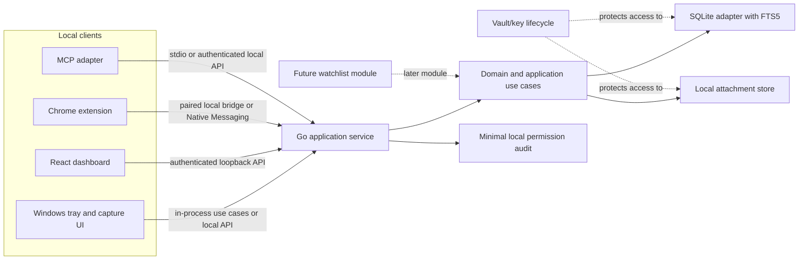

# Proposed Architecture

**Status:** Proposal only; implementation status is tracked in [release-readiness audit](release-readiness-audit.md)
**Product name:** Undecided; use a neutral internal identifier in code and documentation.  
**Scope:** Architecture only. This document does not authorize implementation of deferred capabilities or settle the approval items below.

## 1. Product overview and boundaries

The application is a local-first personal capture and retrieval tool for notes, ideas, tasks, reminders, links, images, screenshots, quotes, code snippets, and personal references. Its core value is quick capture followed by reliable local search and organization. It should remain useful with no network access, account, AI service, or MCP client.

The operator should not receive readable user content. The default deployment has no hosted notes database, mandatory account, analytics containing user content, or background transfer of captures. Optional integrations must be explicit and narrowly scoped.

The product is not a project-management suite, social network, hosted note service, streaming catalogue, or chatbot. The media watchlist is a separate later module. Mobile clients, synchronization, automatic AI organization, OCR, voice capture, and hosted services are out of the initial boundary.

## 2. Core use cases

1. Capture a thought quickly from the desktop and save it to a local inbox.
2. Create, view, edit, pin, archive, restore, and organize notes into user-created collections and tags.
3. Save links with source URL/title and optional selected text or annotation.
4. Attach images or screenshots as local files and associate them with a note.
5. Search note text and metadata locally, with filters for type, date, collection, tags, and status.
6. Export a portable copy and restore from a backup.
7. Use an optional dashboard and optional browser extension as clients of the same local application service.
8. Allow a separately launched MCP adapter to perform only actions explicitly granted by the user.

Reminders, resurface/memory lane, sticky notes, themes, companion animation, and rich Markdown are plausible follow-on features; they need not block the first capture/search loop.

## 3. System architecture

The Go application service is the business-logic boundary and sole owner of persistence. It exposes use cases through a loopback HTTP API. The desktop shell, dashboard, browser extension bridge, and MCP adapter are clients; none opens SQLite or manipulates database files directly.

The initial process model can keep the Go service and tray shell in one desktop process, with the dashboard and MCP adapter as optional clients/processes. A separate service process can be evaluated if lifecycle or platform integration requires it. Keep domain and use-case packages independent of transport and UI packages so this choice does not leak into business logic.

Suggested layers:

- **Domain:** capture records, collections, tags, attachment metadata, validation and domain rules.
- **Application:** use cases and interfaces/ports for repositories, clock, IDs, and file storage.
- **Adapters:** SQLite repositories, attachment filesystem store, HTTP API, desktop integration, MCP protocol adapter.
- **Composition root:** configuration, dependency wiring, process lifecycle and platform-specific setup.

Adapters call application interfaces. The application layer does not depend on HTTP, React, browser APIs, MCP SDK types, or SQLite details.

## 4. Go backend structure

Proposed Go packages (final names can follow the chosen module layout):

- `cmd/desktop`: desktop/tray executable and composition root.
- `cmd/mcp`: optional standalone MCP executable if the chosen client transport requires it.
- `internal/domain`: core entities, invariants, and typed domain errors.
- `internal/app`: use cases and repository/file-store interfaces.
- `internal/store/sqlite`: SQLite connection setup, migrations, repositories, and FTS implementation.
- `internal/attachments`: safe attachment paths, file operations, MIME checks, and checksums.
- `internal/httpapi`: route handlers, request validation, auth/origin controls, and API DTOs.
- `internal/desktop`: tray, global shortcut, quick capture window, and OS-specific code.
- `internal/vault`: vault lifecycle and integration with selected maintained cryptographic and OS credential libraries; no custom cryptography.
- `internal/mcp`: MCP tools/resources, scope checks, protocol translation, and audit events; calls application use cases or the local API, never the store.
- `internal/config`: local paths and non-secret settings.
- `docs/decisions`: architecture decision records.

Keep packages small and feature-oriented where this is clearer than broad technical buckets. Avoid exporting internal implementation packages as public libraries until there is a real reuse requirement.

## 5. SQLite data storage architecture

Use one local SQLite database per user profile/vault, with foreign keys enabled, explicit migrations, transactions for multi-record operations, and SQLite FTS5 for title/body search. Keep schema and migration code inside the storage adapter. The application service owns migration execution and database lifecycle.

Likely initial tables include `notes`, `collections`, `tags`, `note_tags`, `attachments`, and schema/migration metadata. Note fields may include stable ID, title/body, type, status, collection, pin state, timestamps, archive/trash timestamps, and optional reminder time. Store relationships with foreign keys and indexes. Define whether attachment metadata and searchable text are encrypted as part of the vault decision.

FTS5 should be maintained transactionally from note writes, using triggers or explicit repository updates. Triggers reduce missed index updates; explicit updates make behavior more visible in application code. Choose and test one approach before implementation. FTS indexes can duplicate sensitive text and must receive the same protection as source content. Verify that the selected database-encryption approach supports FTS5 and backup/restore requirements before committing to it.

Store large attachment bytes as files in an application-managed vault directory, not as large SQLite blobs by default. SQLite stores an opaque relative identifier and metadata. File access must validate paths, avoid traversal, use atomic writes where possible, and clean up orphan files safely. This split improves streaming and reduces database size, but means database and attachment backup/restore must be coordinated.

Do not assume that encrypting only individual note bodies protects metadata, indexes, WAL/journal files, temporary files, or backups. The encryption boundary must be selected and verified as a whole.

## 6. Encryption and key-management design considerations

Encryption is a design gate, not an invitation to implement cryptographic primitives. Select maintained, reviewed libraries and supported operating-system credential facilities. Do not claim the result is secure or audited without evidence and independent review.

Compare at least these approaches before implementation:

- **Whole-database encryption:** simplifies protection of SQLite pages and FTS data, but depends on a vetted SQLite encryption implementation, licensing, platform builds, and correct handling of WAL/journal/temp files.
- **Application-level field/file encryption:** can use established authenticated-encryption APIs while retaining stock SQLite, but requires careful treatment of indexes, metadata leakage, migrations, key rotation, and queryability. Search over encrypted content is not available through ordinary FTS5 without exposing plaintext in an index or adding a more complex design.
- **OS-account protection only:** simpler user experience, but may not protect against another process running as the same user or provide portable encrypted backups.

Key lifecycle decisions include password-based key derivation parameters, random salts/nonces, key wrapping, OS credential storage, unlock/lock behavior, crash recovery, key rotation, recovery options, and handling of forgotten passwords. The product must explain that loss of the only usable key may make data unrecoverable. A recovery key improves recoverability but creates another secret that must be stored safely.

During unlock, plaintext keys necessarily exist in process memory. Locking should close or invalidate access and minimize key lifetime, while acknowledging that memory wiping and protection from malware/administrators cannot be guaranteed in a general-purpose OS. Decide whether quick capture while locked is unavailable or uses a clearly disclosed limited plaintext queue; the safer baseline is to require unlock.

Do not start storing real user data until database, FTS, attachment, WAL, export, and backup encryption behavior has been demonstrated on supported Windows configurations.

## 7. Desktop application architecture

Use a Windows-first Go desktop process for tray lifecycle, shortcut registration, and an on-demand lightweight capture window. Keep OS-specific code behind narrow interfaces and isolate it by build tags or platform files. The tray should control service lifecycle and expose lock/open/capture/quit actions.

For the capture window, compare a native Windows UI toolkit with a lightweight WebView wrapper. Native UI can reduce runtime footprint but may cost more implementation effort and constrain shared UI. A WebView enables UI reuse with the dashboard but adds runtime and packaging complexity. Avoid Electron unless later evidence shows a strong technical need. Prototype shortcut, tray, focus behavior, suspend/resume, installer, and window lifecycle on Windows before choosing a UI shell.

The desktop shell must not implement business rules separately; it submits commands to the Go application layer. Global shortcut registration must be configurable and handle conflicts gracefully.

## 8. React dashboard integration

Use a React + TypeScript dashboard, with Next.js as the stated frontend direction. Since the initial application is a local single-user utility and does not need public server rendering, compare a static/local-served Next.js export or SPA-style deployment with a simpler Vite SPA before selecting the runtime. Avoid introducing a hosted Next.js server merely to satisfy a framework preference.

The dashboard communicates only with the Go local API using versioned JSON DTOs. It never opens SQLite or attachment paths directly. The Go service applies validation, permissions, and domain rules for all writes. The UI can present optimistic interactions only where errors can be reconciled safely.

If offline PWA behavior is added, cache the application shell, not private note responses by default. Service-worker caching of sensitive data can outlive a vault lock and needs an explicit threat review. Theme preferences may be local client settings; content remains owned by the Go service.

## 9. Browser extension architecture

Start with Chrome Manifest V3 and minimum permissions. The extension can read the active page only when the user invokes a capture action and grants the necessary host/page access. Capture URL/title, user-selected text, and user-selected image or screenshot data through explicit interactions. Do not assume an extension can freely read local files or arbitrary page content.

The extension is an untrusted client of the local API. Compare:

- **Loopback HTTP bridge:** straightforward and compatible with a local service, but requires careful origin/host validation, anti-CSRF protections, short-lived pairing tokens, and defenses against malicious web pages probing localhost.
- **Native Messaging:** browser-managed connection to a registered native host can reduce web-origin exposure, but adds installation, registration, lifecycle, and browser-specific packaging work.

Do not grant broad host access by default. Per-site access or user-invoked active-tab permissions are preferable where the capture workflow permits them. Extension messages should use a narrow schema, and the service must treat every submitted value as untrusted. Firefox support follows after the Chrome path is stable.

## 10. MCP server architecture

The MCP adapter is optional and separate from domain logic. It translates protocol requests into application use cases (or the authenticated local API) and never imports SQLite repositories. Use a maintained Go MCP SDK after verifying its maintenance, supported transport, and client compatibility at implementation time.

Start with read-only tools and bounded result sizes. Grant note-content read separately from metadata read. Create, edit, archive, and permanent delete must be distinct scopes; permanent delete is separately disabled unless explicitly enabled. Attachment access is a separate scope. Prompts and resources do not grant authority. Tool arguments and output are untrusted, and retrieved content may contain prompt injection; treat it as data, not instructions.

Prefer a local stdio transport for clients that launch a subprocess: it avoids opening a listening port but requires per-client process configuration. If a local HTTP transport is needed, bind loopback only, require pairing/authentication, validate origin/host, and reject LAN exposure. Provide per-client revocation and record minimal audit metadata without note bodies or sensitive tool arguments.

## 11. Local API communication

Use a versioned JSON API over loopback HTTP unless platform prototypes favor a named pipe or another local IPC mechanism. HTTP has broad client support and easy debugging; named pipes can reduce exposure to browser-origin attacks but complicate cross-client support. Keep the application use-case interfaces independent so transport can change.

Minimum controls include loopback-only binding, unpredictable per-run or paired bearer credentials, strict Host/Origin checks, request size limits, content-type validation, rate limits where useful, no secrets in URLs, and no permissive CORS. Bind only when needed and shut down cleanly. Do not rely on CORS alone as authentication. The API should never expose raw SQL or filesystem paths.

Define API DTOs separately from database models, version routes, and publish an OpenAPI contract if it improves client generation and review. Error responses must not reveal secrets or private note content unnecessarily.

## 12. Authentication and permissions

The local user session and external client authorization are separate concerns. Desktop unlock controls access to the vault; each extension/dashboard/MCP client needs a scoped local capability. Prefer explicit pairing, clear client identity, revocation, and least privilege.

Permission dimensions should be independently grantable: metadata read, note-content read, attachment read, create, edit, archive, permanent delete, and (later) watchlist read/write. Read-only access is the default. Permanent deletion must have a distinct permission and confirmation UX. Scopes are checked in the application service boundary, not only in UI or transport handlers.

Audit records should contain client ID, action category, target identifier where safe, time, and outcome; never record note body, attachment bytes, passwords, tokens, encryption keys, or full sensitive arguments. Consider metadata leakage from target IDs and timestamps when setting retention.

## 13. Backup and restore architecture

Provide user-initiated export and backup first. A portable export may include documented JSON metadata, Markdown/text content, and attachments with a manifest and checksums. A backup should preserve vault encryption and include database plus attachments as one consistent snapshot.

SQLite backup APIs or a controlled checkpoint/snapshot should be used rather than copying a live database file naively. Coordinate attachment capture with a manifest so restore can detect missing or corrupt files. Restore into a new destination first, validate schema/checksums, and only then allow the user to switch to it. Never overwrite the only source vault during restore.

Trade-off: plaintext interchange exports are easier to inspect and migrate, but can bypass vault protection. Make export encryption an explicit choice, show destination and included content, and warn that ordinary file deletion cannot guarantee secure erasure on SSDs. Automated backup, retention, and recovery-key UX are later decisions.

## 14. Testing strategy

- **Domain unit tests:** validation, state transitions, permissions, archive/restore semantics, and note/collection rules.
- **Application tests:** use-case behavior with fakes for repositories and clocks; ensure adapters cannot bypass authorization.
- **SQLite integration tests:** migrations from clean and prior schemas, foreign keys, transaction rollback, FTS consistency, filtering, and backup snapshot behavior.
- **Attachment tests:** path traversal rejection, MIME/size validation, atomic writes, checksum validation, orphan handling, and restore integrity.
- **API tests:** authentication, origin/host checks, limits, DTO validation, error redaction, and scope enforcement.
- **Desktop checks:** Windows shortcut conflicts, tray lifecycle, unlock/lock, sleep/resume, and packaging in a manual/automated platform matrix.
- **Extension tests:** permission minimization, active-tab capture, malformed messages, and localhost/native bridge abuse cases.
- **MCP tests:** tool schemas, per-tool scopes, revocation, bounded outputs, and no direct storage imports.
- **End-to-end:** capture, close/reopen, search, export, restore, and verify content only after encryption design is selected.

Use synthetic fixtures only. Never place private user notes or real keys in tests, logs, crash reports, or prompts. Add dependency and static analysis checks as part of release hardening. Cryptographic claims require independent review beyond passing tests.

## 15. Security and privacy threat model

**Assets:** note content, titles, URLs, tags, collection names, attachment bytes, encryption keys, local auth tokens, backups, and activity metadata.

**Threat actors/events:** lost or stolen device; another process under the same OS account; malware or administrator access; malicious web page probing a local API; compromised extension; malicious or over-permissioned MCP client; accidental export/backup exposure; dependency compromise; corrupted database or attachment; logs/crash reports leaking content.

**Trust boundaries:** OS user/session; locked vs unlocked vault; Go service vs local clients; browser page vs extension; MCP host/model vs local adapter; vault directory vs export destination. Data crossing any boundary is untrusted and should be minimized.

**Mitigations to design and verify:** encryption at rest with vetted components; local-only default; explicit unlock and client grants; scoped authorization at use-case boundaries; loopback/IPC hardening; strict extension permissions; attachment path validation; data-free logs; encrypted and integrity-checked backups; dependency review; revocation and deletion semantics; clear disclosure when a user explicitly sends selected text to an external AI provider.

**Residual limits:** local encryption cannot protect content while unlocked from malware with equivalent privileges, a compromised OS, a malicious client already granted content access, screenshots, or plaintext exports. Metadata may remain visible depending on the chosen encryption boundary. Secure deletion on modern storage cannot be guaranteed. Do not describe the design as audited or secure absent evidence.

## 16. Future watchlist module

Treat watchlist as a separate Part 2 domain module with its own entities, use cases, migrations, API routes, and optional MCP scopes. It may share the application service, vault, backup, and client infrastructure, but should not distort the initial capture domain. Candidate fields include media type, title, status, progress, rating, explicit likes/dislikes, and user-provided notes. Keep catalogue acquisition, recommendations, and external metadata providers out of the first release. If added, begin with user-entered data and explainable local rules.

## 17. Deferred features

Defer hosted sync, cloud accounts, mobile clients, remote access, telemetry, external AI calls, AI auto-organization, OCR, voice capture, public sharing, social features, marketplace, streaming/catalogue integrations, recommendation models, automatic update service, continuous clipboard monitoring, broad extension host permissions, and permanent deletion workflows until separately scoped and approved. Optional companion animation, advanced themes, sticky windows, memory lane, and rich reminders should follow the reliable capture/search baseline.

## Proposed folder structure

```text
.
├── cmd/
│   ├── desktop/                 # Windows-first tray/application entry point
│   └── mcp/                     # Optional MCP process entry point
├── internal/
│   ├── domain/                  # Core entities and invariants
│   ├── app/                     # Use cases and ports
│   ├── store/sqlite/            # SQLite repositories and migrations
│   ├── attachments/             # Vault file storage adapter
│   ├── vault/                   # Lock/unlock and vetted crypto integration
│   ├── httpapi/                 # Local API and authorization middleware
│   ├── desktop/                 # Tray, shortcut, capture window adapters
│   ├── mcp/                     # MCP protocol adapter and scopes
│   └── config/                  # Paths and non-secret configuration
├── web/                         # React + TypeScript dashboard/PWA client
├── extension/                   # Chrome MV3 extension client
├── docs/
│   ├── architecture.md
│   └── decisions/               # ADRs, including pending decisions
└── tests/                       # Cross-adapter/end-to-end fixtures as needed
```

The structure is illustrative. Do not create empty package trees until a feature needs them. Keep secrets, user vaults, generated binaries, and real personal content out of source control.

## Architecture diagram



## Important decisions requiring approval

1. **Encryption boundary and key recovery:** whole-database encryption vs application-level encryption; password/OS credential interaction; recovery key policy. This determines search feasibility, dependency/licensing, backup behavior, and user data-loss risk.
2. **Windows desktop UI/runtime:** native UI vs lightweight WebView, and whether the Go service shares the tray process or runs separately. Requires a Windows proof of concept.
3. **Local API transport and pairing:** loopback HTTP vs named pipe/other IPC; credential lifetime and origin checks. Extension compatibility materially changes the threat surface.
4. **Browser extension bridge and permissions:** Native Messaging vs loopback bridge, active-tab vs broader host permissions, and whether screenshot/image capture is in the first extension increment.
5. **MCP transport and scope UX:** stdio subprocess vs authenticated loopback transport; how grants, revocation, and permanent-delete permission are presented.
6. **Dashboard deployment:** Next.js runtime/deployment strategy vs Vite SPA. Avoid hosted infrastructure; decide whether Next is a strict requirement or a preferred direction.
7. **Backup/export format:** encrypted backup vs portable plaintext interchange export defaults, retention, restore validation, and recovery behavior.
8. **Initial feature boundary:** whether reminders, image capture, rich Markdown, themes, or companion features are in the first usable milestone.

No cloud service, hosted database, telemetry, external AI API, broad extension access, destructive migration, or paid infrastructure is proposed by this document.

## Recommended implementation order

1. Review and approve the encryption/key lifecycle, local transport, Windows desktop shell, and initial MVP boundary before storing real data.
2. Spike Windows tray/shortcut/window behavior and validate SQLite/FTS and candidate encryption-library compatibility, including attachments and backups.
3. Define domain types, application use cases, schema/migration policy, and data-free logging rules.
4. Implement the smallest local capture/search loop in Go: create, retrieve, edit, archive/restore, collections/tags, SQLite FTS, and attachment handling if approved.
5. Add the authenticated local API and permission boundary; exercise lock/unlock and error handling.
6. Add the Windows tray and quick capture shell against the application interfaces.
7. Add documented export and verified restore before broadening client integrations.
8. Add the React dashboard as an API client.
9. Add Chrome extension capture using the approved bridge and minimum permissions.
10. Add MCP capabilities with per-client read-only grants by default, then explicitly provision write/archive scopes, revocation, and content-free audit.
11. Harden packaging, accessibility, recovery, and threat-model checks; only then consider deferred delight features.
12. Design and implement the watchlist as a separate Part 2 module.
